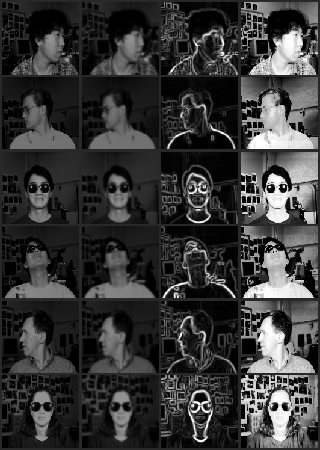

# GPU Batch Image Processor (CUDA at Scale for the Enterprise)

A CUDA program that processes **hundreds of images in a single run**. Every
image in an input folder goes through a three-stage GPU pipeline: Gaussian
blur, Sobel edge detection and histogram equalization. Each GPU result is
checked against a CPU implementation, and per-image timings, sample outputs
and a montage image are saved as proof of execution.



*Each row of `output/montage.png` is one face from the dataset. Columns:
original, Gaussian blur, Sobel edges, histogram equalization.*

## Dataset

[CMU Face Images](https://archive.ics.uci.edu/dataset/124/cmu+face+images)
(UCI Machine Learning Repository, Mitchell 1997): 20 people photographed with
different poses, expressions and with or without sunglasses, stored as 8-bit
PGM files at three resolutions (128x120, 64x60 and 32x30). That makes
**hundreds of small images**, which is one of the two data shapes the
assignment asks for. `data/download_data.sh` downloads and extracts it (about
10 MB).

## What the GPU does

| Stage | Kernel | CUDA technique |
|---|---|---|
| 1. Gaussian blur (5x5) | `GaussianBlurKernel` | One thread per pixel on a 2D grid; filter weights in `__constant__` memory (every thread reads the same weights, which is the access pattern the constant cache is built for) |
| 2. Sobel edge detection | `SobelKernel` | Runs on the blurred image, still on the device, so no extra host transfer is needed |
| 3a. Histogram | `HistogramKernel` | Each block builds a private histogram in `__shared__` memory with fast shared atomics, then merges it into global memory with one atomic per bin |
| 3b. Equalization table | `EqualizationLutKernel` | Cumulative distribution turned into a 256-entry lookup table |
| 3c. Apply table | `ApplyLutKernel` | One thread per pixel |

**Concurrency:** images are distributed round-robin over N non-blocking CUDA
streams (`--streams`). Each stream has its own **pinned** host buffers (needed
for truly asynchronous `cudaMemcpyAsync`) and device buffers, so the upload of
one image overlaps with the kernels and downloads of others. CUDA events
measure the time each image spends on the GPU.

**Verification:** after the GPU pass, the same three algorithms are run on the
CPU and every output pixel is compared. The blur uses integer weights (the
binomial row 1-4-6-4-1, total 256) and the equalization uses integer
arithmetic, so a correct GPU result is *bit-for-bit identical* to the CPU one.
The program reports `PASSED` only if all images match exactly.

## Project layout

```
bin/      compiled executable (created by make)
data/     download_data.sh; the dataset is extracted here
lib/      (no external libraries needed)
output/   log.txt, timings.csv, montage.png, samples/ (proof of execution)
src/      image_batch_processor.cu (kernels + pipeline), image_io.h (PGM/PNG I/O)
INSTALL   installation steps
Makefile  build / run / clean targets
run.sh    download data (if needed) + build + run + save the log
```

## Build and run

Requirements: an NVIDIA GPU, the CUDA Toolkit (`nvcc`), make and bash. No other
libraries are needed (see `INSTALL`).

```bash
./run.sh                     # downloads data if needed, builds, runs, writes output/log.txt
```

or step by step:

```bash
bash data/download_data.sh
make build
./bin/image_batch_processor --input data --output output --streams 4 --samples 6
```

### Command-line arguments

| Argument | Default | Meaning |
|---|---|---|
| `--input <dir>` | `data` | Folder searched **recursively** for `.pgm` images |
| `--output <dir>` | `output` | Where results are written |
| `--streams <n>` | `4` | Number of CUDA streams (1-32) |
| `--block <n>` | `16` | Edge of the 2D thread block for the per-pixel kernels (n x n threads) |
| `--samples <n>` | `6` | Number of images saved as PNG and shown in the montage |
| `--save_all` | off | Also save every processed image (3 PGM files per input) to `output/all/` |
| `--help` | | Print usage |

Extra arguments given to `run.sh` are passed through, e.g.
`./run.sh --streams 8 --block 32`.

## Proof of execution

All of these are in `output/` and come from **one execution** over the whole
dataset:

* `log.txt` - the full console output: the GPU name, how many images were
  found and loaded, one line per processed image (size, GPU time,
  verification result), and a summary with totals, throughput, the
  stream-overlap factor and the CPU verification result.
* `timings.csv` - one row per image: file, size, GPU time in ms, maximum
  pixel difference from the CPU reference, verification status.
* `montage.png` - the montage shown above.
* `samples/` - original, blurred, edge and equalized PNGs for the sample
  images.

## Lessons learned

* **Small images are dominated by overhead.** One 128x120 image is only about
  15k pixels, so each launch finishes almost immediately and launch latency
  plus PCIe transfer time take up most of the GPU time. Streams help here:
  while one image's kernels run, another image is being copied. The "stream
  overlap factor" in the log (sum of per-image GPU times divided by wall time)
  shows how much work actually ran concurrently. For a dataset like this, the
  way you batch the work matters as much as the kernels themselves.
* **Pinned memory is required for asynchronous copies.** `cudaMemcpyAsync`
  from ordinary pageable memory silently becomes synchronous, which would
  serialize the streams. Every stream therefore owns `cudaMallocHost` buffers.
* **Design for verifiability.** My first idea used floating-point Gaussian
  weights. Because the GPU fuses multiply-adds (FMA) and the CPU may not,
  results could differ by 1 grey level, which makes "is my kernel correct?"
  hard to answer. Switching to integer weights made GPU and CPU results
  identical, so verification is an exact comparison.
* **Shared-memory atomics.** If every thread did `atomicAdd` directly on a
  256-bin global histogram, thousands of threads would contend for the same
  few addresses. Giving each block a private shared-memory histogram turns
  most of those into fast on-chip atomics and leaves only 256 global atomics
  per block.
* **Keep intermediate data on the device.** The blur output goes straight
  into the Sobel kernel without a round trip to the host, and only the final
  results are copied back.

## Possible extensions

* Use NPP (`nppiFilterGaussBorder`, `nppiFilterSobel...`, `nppiHistogramEven`)
  and compare its speed with these hand-written kernels.
* Process a few very large images in tiles with shared-memory halos.
* Batch many small images into one launch to cut down the per-launch overhead.
